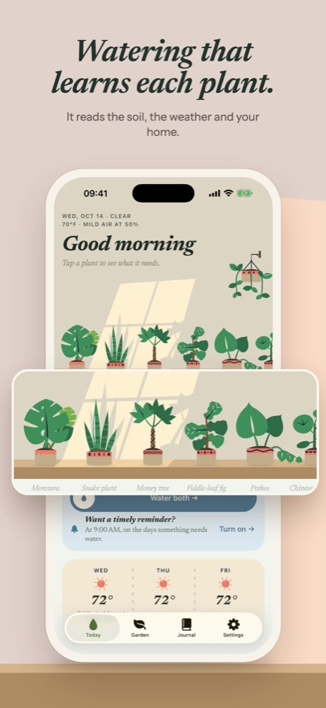
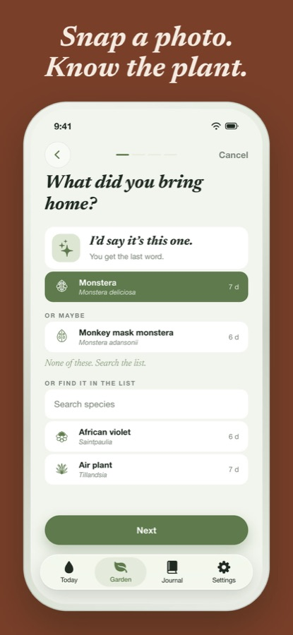
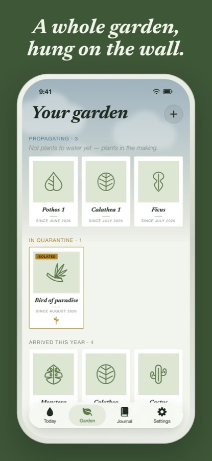
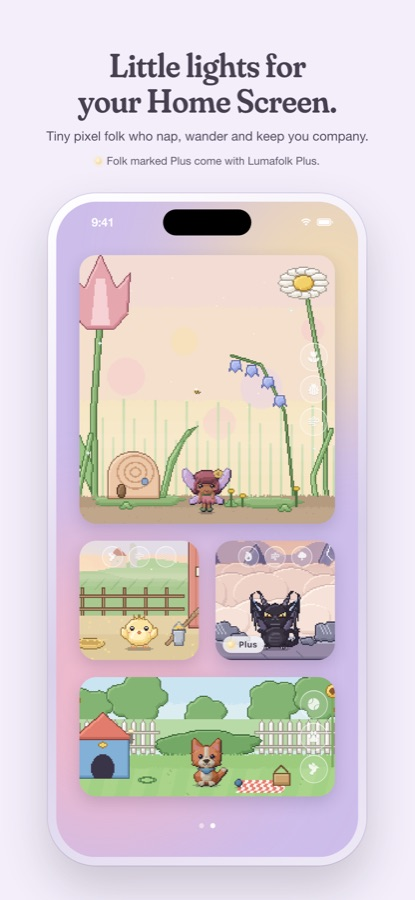
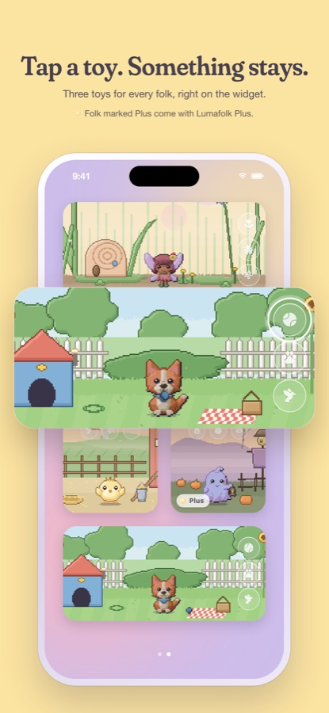
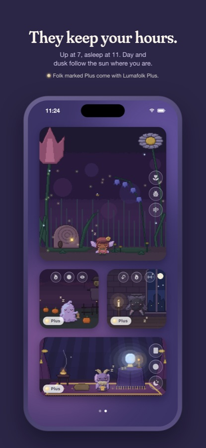

<picture>
  <source media="(max-width: 600px) and (prefers-color-scheme: dark)" srcset="assets/home-narrow-dark.svg">
  <source media="(max-width: 600px)" srcset="assets/home-narrow-light.svg">
  <source media="(prefers-color-scheme: dark)" srcset="assets/home-dark.svg">
  
</picture>

  <a href="https://plantempo.app/?utm_source=github&utm_medium=readme"><b>plantempo.app</b></a> ·
  <a href="https://lumafolk.com/?utm_source=github&utm_medium=readme"><b>lumafolk.com</b></a> ·
  <a href="https://www.linkedin.com/in/gerardo-pacheco-sicart/">LinkedIn</a>

## Plantempo

A plant-care app I designed and built on my own. It reads your local weather, asks you to touch the soil now and then, and learns how fast each plant really dries. One reminder a day, only when it counts. Free, with no account and no ads.

[App Store](https://apps.apple.com/app/id6789923852?pt=129157277&ct=github-readme&mt=8) · [Google Play](https://play.google.com/store/apps/details?id=app.plantempo.Plantempo&referrer=utm_source%3Dgithub%26utm_medium%3Dreadme)

  &nbsp;
  &nbsp;
  

**Under the hood:** Expo Router, React Native and TypeScript. Skia and Reanimated for the animated scenes, SQLite on the device, and native Swift modules for home-screen widgets, Siri shortcuts and iCloud sync. Plant identification runs on the device on iPhone. Translated into 11 languages with Lingui, released with fastlane.

## Lumafolk

Tiny pixel-art folk who live in your Home Screen widgets. They nap, wander round their little worlds, sleep at night and play with the toys you tap. More than thirty folk to meet, and three of them are free, always. For iPhone and iPad.

[App Store](https://apps.apple.com/app/id6817874976?pt=129157277&ct=github-readme&mt=8)

  &nbsp;
  &nbsp;
  

**Under the hood:** native Swift. A SwiftUI app and a WidgetKit extension that animates pixel art on the Home Screen within iOS's tight memory and CPU limits for widgets, drawn at its real size and scaled pixel-exact. Liquid Glass on iOS 26, StoreKit 2 for Lumafolk Plus, and all 11 App Store languages. The art and widget frames come from my own Python pipeline.

## Version history

`17.1` · Oct 2026  
**Lumafolk.** Launched my second app, just in time for Halloween.  
Added: a Halloween pack. Candil, Murci and Seta moved in.

`17.0` · Jul 2026  
**Plantempo.** Launched my own plant-care app on iPhone and Android.  
Fixed: the monstera no longer gets watered twice.

`16.0` · Nov 2025  
**XRF.** Senior Software Engineer. Hybrid, Madrid.

`15.0` · Nov 2024  
**Sabbatical.** Three months off to recharge.  
Maintenance release. No new features, on purpose.

`10.0` · Nov 2019  
**Automattic.** Five years on the Gutenberg editor for the WordPress iOS and Android apps, fully remote: features, upgrades, UI, performance and test automation.  
Added: native bridges in Swift and Kotlin, Appium end-to-end tests.

`9.0` · Jul 2018  
**Lingokids.** Performance on older devices, deep links, Detox end-to-end tests and AppsFlyer attribution.

`8.0` · Jun 2017  
**Gudog.** Push and in-app notifications, WebSocket chat, deep links and Branch attribution.

`6.0` · Jan 2015  
**Vizzuality.** Front-end developer and team lead. D3 visualizations, interactive maps and my first React Native apps.

`3.0` · Feb 2012  
**TAPTAP Networks.** Mobile web with Backbone and Node.js.

`1.0` · Oct 2010  
**Creatibox.** Initial release: PHP, MySQL, WordPress and Joomla.

## Open source

Merged pull requests in [WordPress/gutenberg](https://github.com/WordPress/gutenberg/pulls?q=is%3Apr+author%3Ageriux+is%3Aclosed) and [wordpress-mobile/gutenberg-mobile](https://github.com/wordpress-mobile/gutenberg-mobile/pulls?q=is%3Apr+author%3Ageriux+is%3Aclosed).
